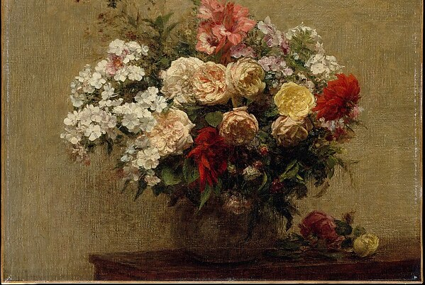
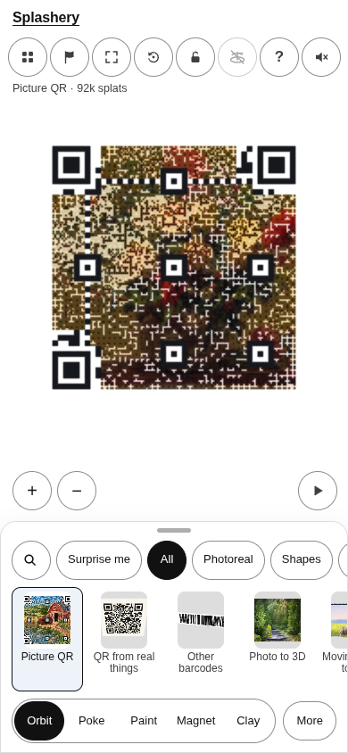
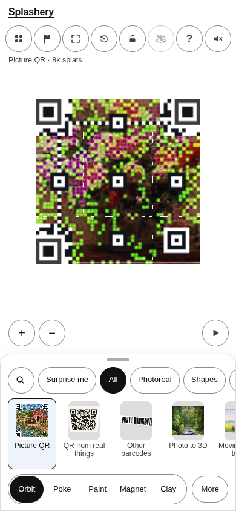
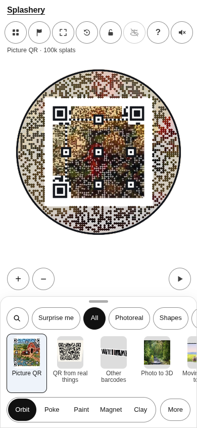
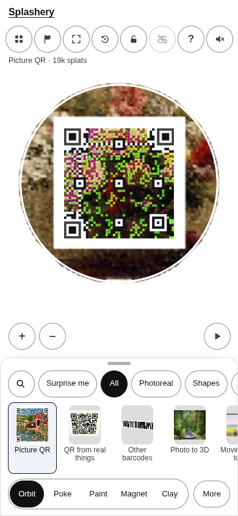

# Summer Flowers

[All pictures](../README.md)

Source: [Henri Fantin-Latour](https://www.metmuseum.org/art/collection/search/438031). Rendered by
Ryan with Codex (GPT-6); source credits remain in [CREDITS](../../../../CREDITS.md).

Source pixels used by the measure. The toy takes a central crop; Circle uses a smaller central crop
for its encoded square.

## Square

Mean SSIM over 10/10 payloads: phone 0.1438 → 0.4276; print 0.1346 → 0.4209.

| Main · Standard                                             | Most detail                                                      |
| ----------------------------------------------------------- | ---------------------------------------------------------------- |
|  |  |

## Circle

Mean SSIM over 10/10 payloads: phone 0.2531 → 0.4463; print 0.1864 → 0.4130.

| Main · Standard                                             | Most detail                                                      |
| ----------------------------------------------------------- | ---------------------------------------------------------------- |
|  |  |
