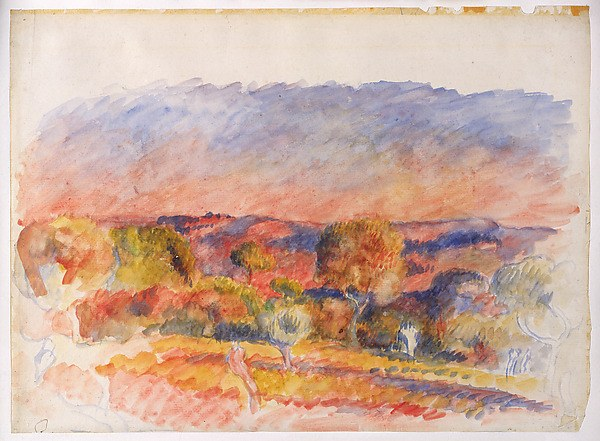
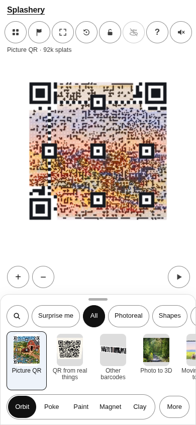
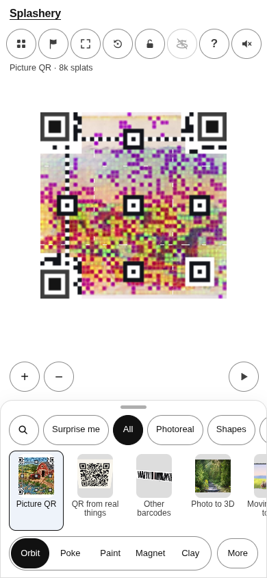
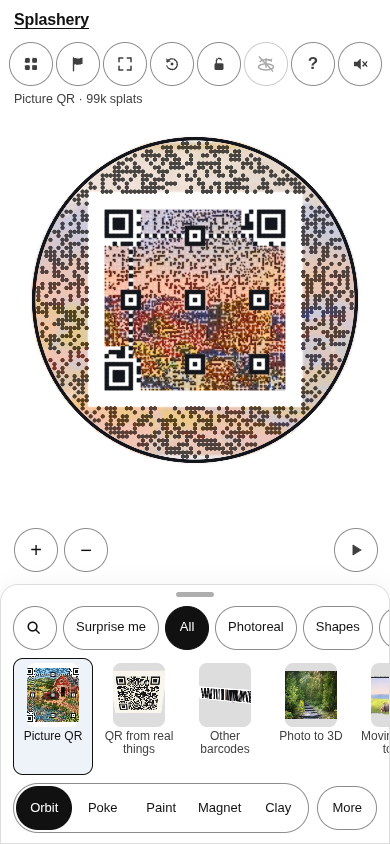
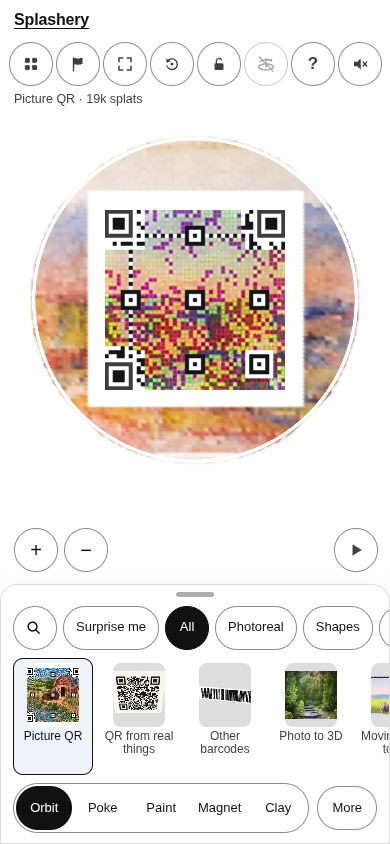

# Landscape

[All pictures](../README.md)

Source: [Auguste Renoir](https://www.metmuseum.org/art/collection/search/459968). Rendered by Ryan
with Codex (GPT-6); source credits remain in [CREDITS](../../../../CREDITS.md).

Source pixels used by the measure. The toy takes a central crop; Circle uses a smaller central crop
for its encoded square.

## Square

Mean SSIM over 10/10 payloads: phone 0.1427 → 0.3737; print 0.1327 → 0.3665.

| Main · Standard                                             | Most detail                                                      |
| ----------------------------------------------------------- | ---------------------------------------------------------------- |
|  |  |

## Circle

Mean SSIM over 10/10 payloads: phone 0.2523 → 0.4047; print 0.1675 → 0.3652.

| Main · Standard                                             | Most detail                                                      |
| ----------------------------------------------------------- | ---------------------------------------------------------------- |
|  |  |
