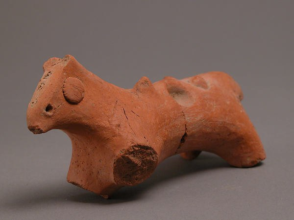
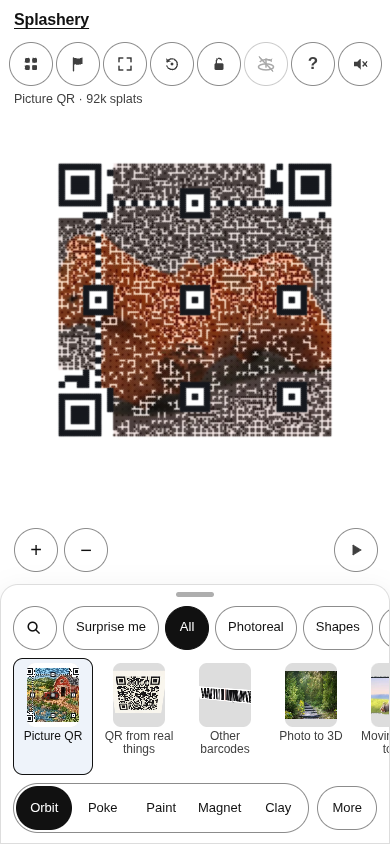
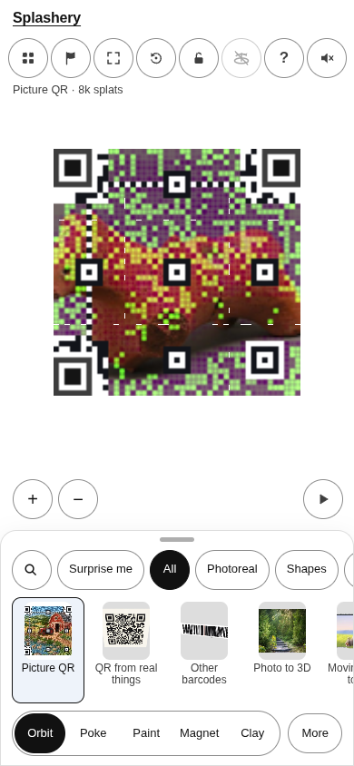
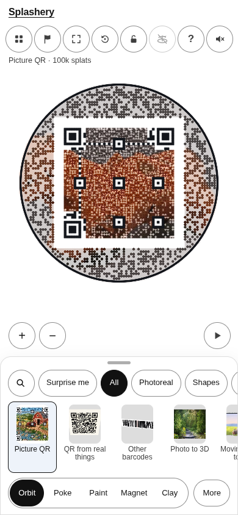
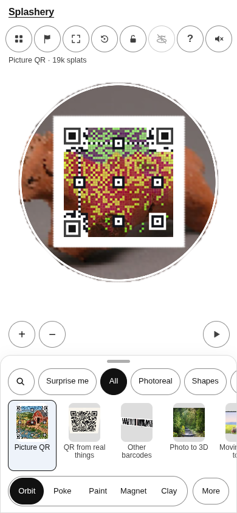

# Animal

[All pictures](../README.md)

Source: [Coptic](https://www.metmuseum.org/art/collection/search/478467). Rendered by Ryan with
Codex (GPT-6); source credits remain in [CREDITS](../../../../CREDITS.md).

Source pixels used by the measure. The toy takes a central crop; Circle uses a smaller central crop
for its encoded square.

## Square

Mean SSIM over 10/10 payloads: phone 0.1542 → 0.3494; print 0.1457 → 0.3398.

| Main · Standard                                             | Most detail                                                      |
| ----------------------------------------------------------- | ---------------------------------------------------------------- |
|  |  |

## Circle

Mean SSIM over 10/10 payloads: phone 0.1664 → 0.3583; print 0.0954 → 0.3148.

| Main · Standard                                             | Most detail                                                      |
| ----------------------------------------------------------- | ---------------------------------------------------------------- |
|  |  |
