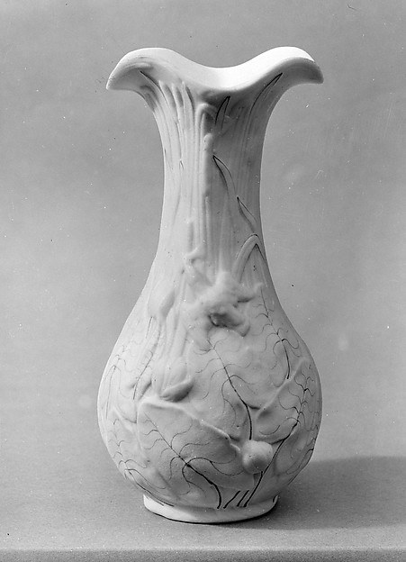
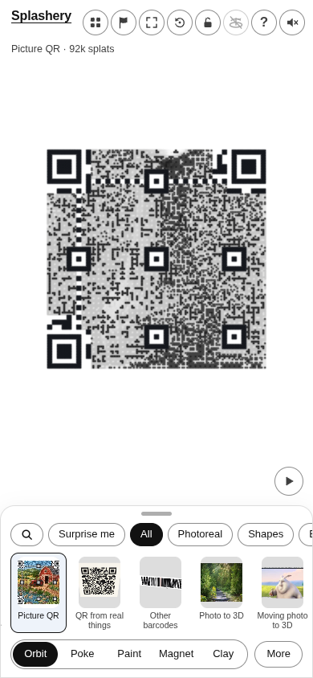
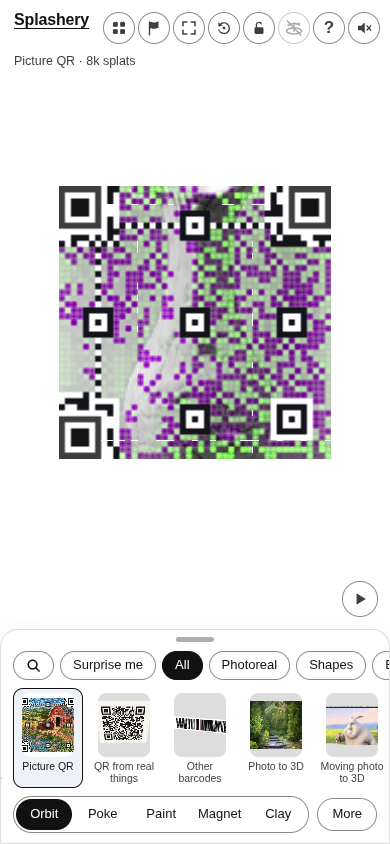
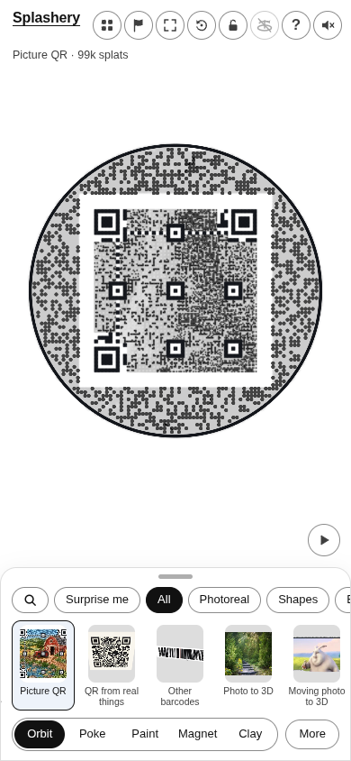
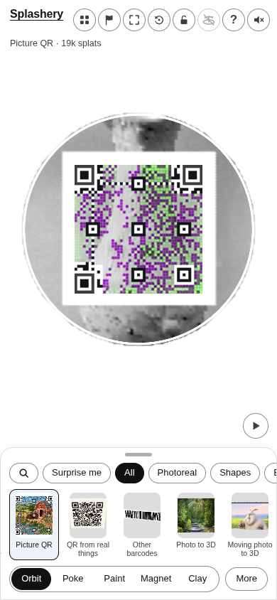

# Vase

[All pictures](../README.md)

Source: [American](https://www.metmuseum.org/art/collection/search/9283). Rendered by Ryan with
Codex (GPT-6); source credits remain in [CREDITS](../../../../CREDITS.md).

Source pixels used by the measure. The toy takes a central crop; Circle uses a smaller central crop
for its encoded square.

## Square

Mean SSIM over 10/10 payloads: phone 0.2100 → 0.3034; print 0.2020 → 0.2949.

| Main · Standard                                           | Most detail                                                    |
| --------------------------------------------------------- | -------------------------------------------------------------- |
|  |  |

## Circle

Mean SSIM over 10/10 payloads: phone 0.1651 → 0.3523; print 0.0967 → 0.3108.

| Main · Standard                                           | Most detail                                                    |
| --------------------------------------------------------- | -------------------------------------------------------------- |
|  |  |
