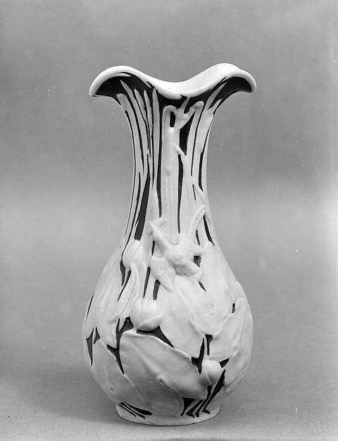
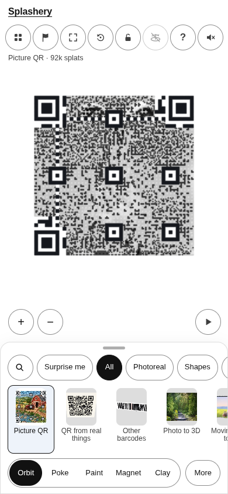
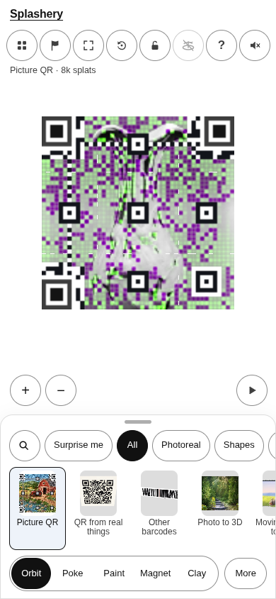
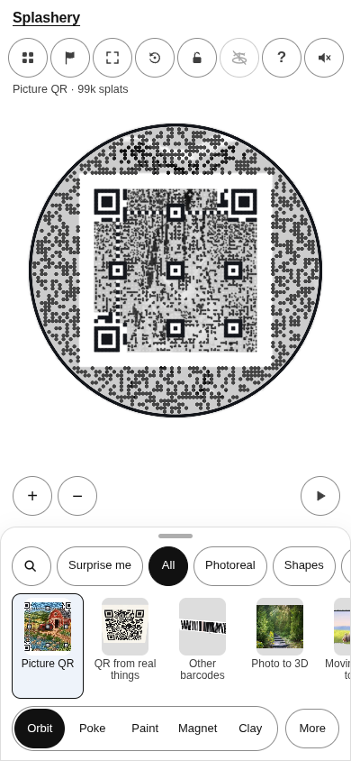
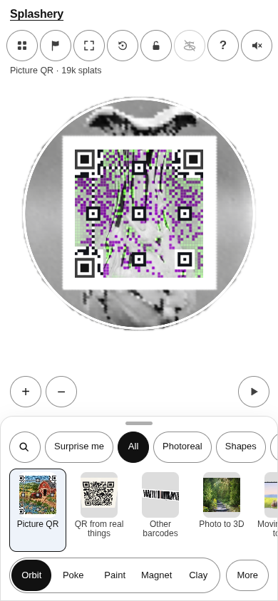

# Vase

[All pictures](../README.md)

Source: [American](https://www.metmuseum.org/art/collection/search/9284). Rendered by Ryan with
Codex (GPT-6); source credits remain in [CREDITS](../../../../CREDITS.md).

Source pixels used by the measure. The toy takes a central crop; Circle uses a smaller central crop
for its encoded square.

## Square

Mean SSIM over 10/10 payloads: phone 0.2370 → 0.3766; print 0.2299 → 0.3687.

| Main · Standard                                           | Most detail                                                    |
| --------------------------------------------------------- | -------------------------------------------------------------- |
|  |  |

## Circle

Mean SSIM over 10/10 payloads: phone 0.2091 → 0.4214; print 0.1579 → 0.3856.

| Main · Standard                                           | Most detail                                                    |
| --------------------------------------------------------- | -------------------------------------------------------------- |
|  |  |
