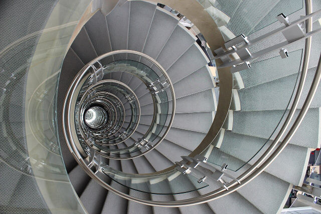
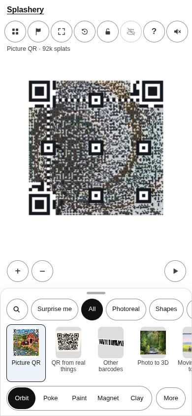
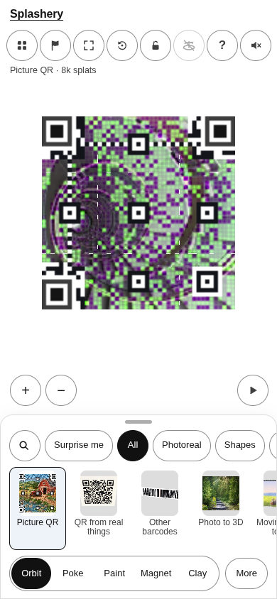
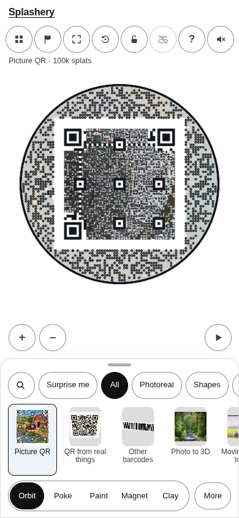
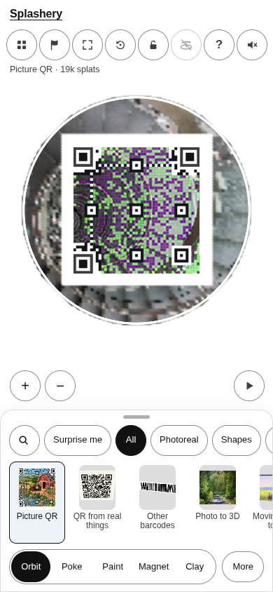

# A spiral staircase

[All pictures](../README.md)

Source:
[Jorge Mendoza](<https://commons.wikimedia.org/wiki/File:Spiral_Staircase,_Keck_Center_(U.S._National_Academies).jpg>).
Rendered by Ryan with Codex (GPT-6); source credits remain in [CREDITS](../../../../CREDITS.md).

Source pixels used by the measure. The toy takes a central crop; Circle uses a smaller central crop
for its encoded square.

## Square

Mean SSIM over 10/10 payloads: phone 0.1679 → 0.4629; print 0.1576 → 0.4561.

| Main · Standard                                                | Most detail                                                         |
| -------------------------------------------------------------- | ------------------------------------------------------------------- |
|  |  |

## Circle

Mean SSIM over 10/10 payloads: phone 0.2862 → 0.4571; print 0.2053 → 0.4161.

| Main · Standard                                                | Most detail                                                         |
| -------------------------------------------------------------- | ------------------------------------------------------------------- |
|  |  |
