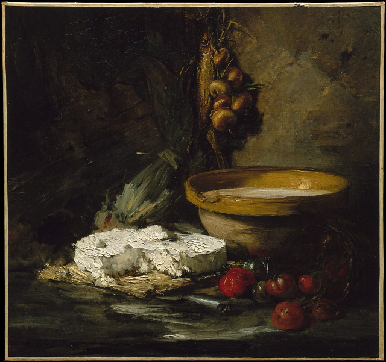
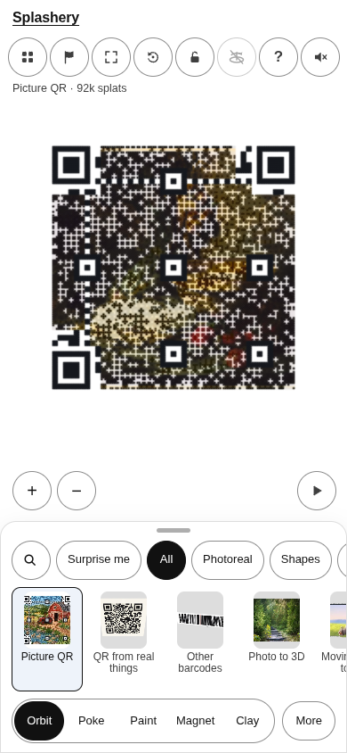
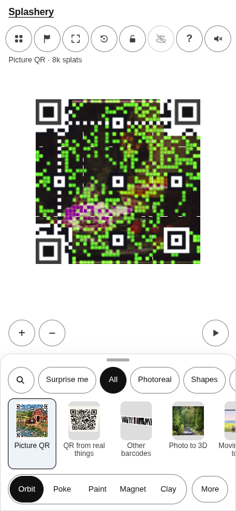
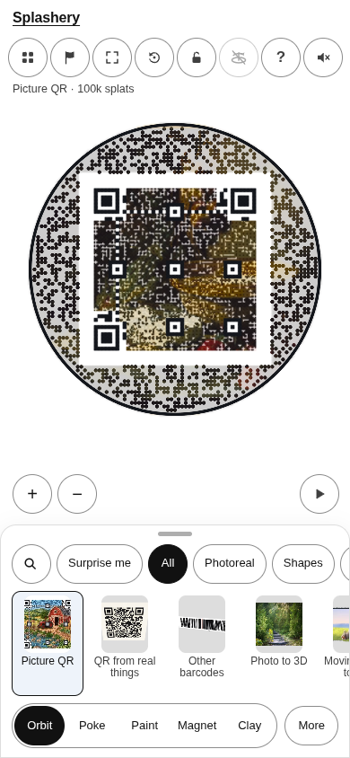
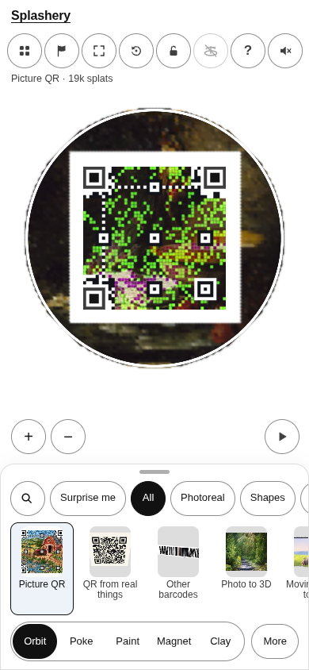

# Still life with cheese (a painting)

[All pictures](../README.md)

Source:
[Antoine Vollon (Metropolitan Museum of Art Open Access)](https://commons.wikimedia.org/wiki/File:Still_Life_with_Cheese_MET_DT1989.jpg).
Rendered by Ryan with Codex (GPT-6); source credits remain in [CREDITS](../../../../CREDITS.md).

Source pixels used by the measure. The toy takes a central crop; Circle uses a smaller central crop
for its encoded square.

## Square

Mean SSIM over 10/10 payloads: phone 0.0896 → 0.3144; print 0.0842 → 0.3069.

| Main · Standard                                             | Most detail                                                      |
| ----------------------------------------------------------- | ---------------------------------------------------------------- |
|  |  |

## Circle

Mean SSIM over 10/10 payloads: phone 0.1885 → 0.3726; print 0.1279 → 0.3349.

| Main · Standard                                             | Most detail                                                      |
| ----------------------------------------------------------- | ---------------------------------------------------------------- |
|  |  |
