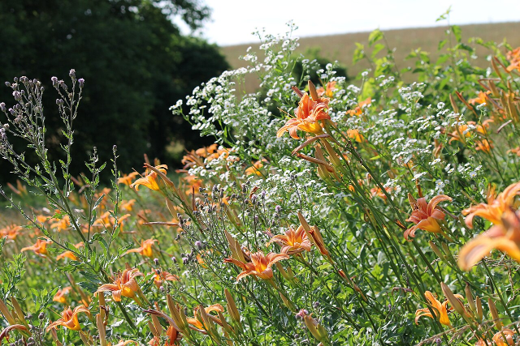
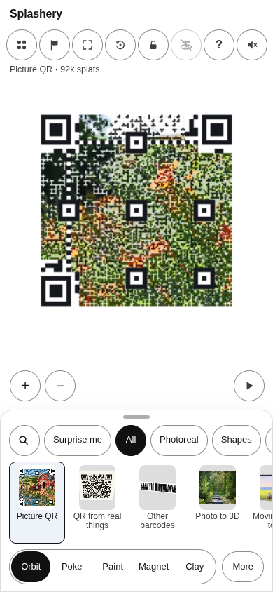
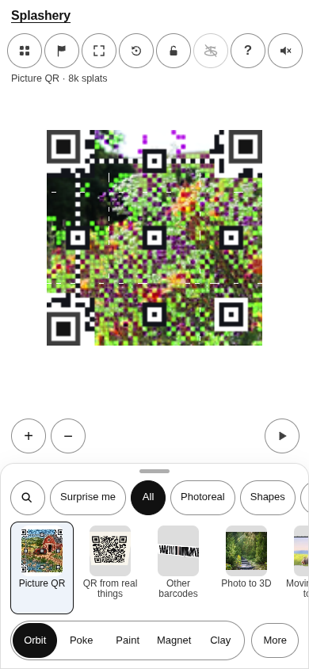
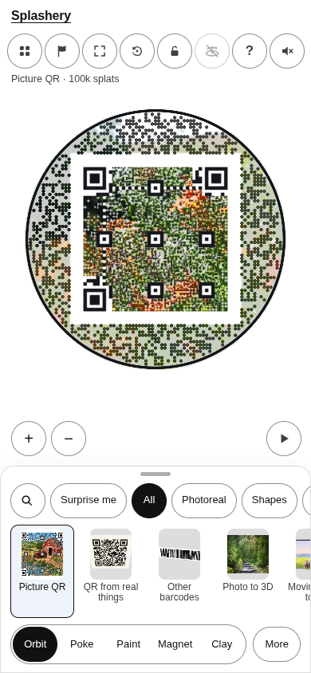
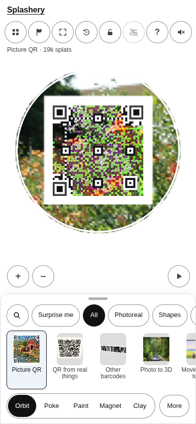

# Wildflowers

[All pictures](../README.md)

Source: [PookieFugglestein](https://commons.wikimedia.org/wiki/File:Wildflowers_in_foreground.JPG).
Rendered by Ryan with Codex (GPT-6); source credits remain in [CREDITS](../../../../CREDITS.md).

Source pixels used by the measure. The toy takes a central crop; Circle uses a smaller central crop
for its encoded square.

## Square

Mean SSIM over 10/10 payloads: phone 0.1843 → 0.4849; print 0.1747 → 0.4809.

| Main · Standard                                              | Most detail                                                       |
| ------------------------------------------------------------ | ----------------------------------------------------------------- |
|  |  |

## Circle

Mean SSIM over 10/10 payloads: phone 0.4312 → 0.5473; print 0.3491 → 0.5198.

| Main · Standard                                              | Most detail                                                       |
| ------------------------------------------------------------ | ----------------------------------------------------------------- |
|  |  |
